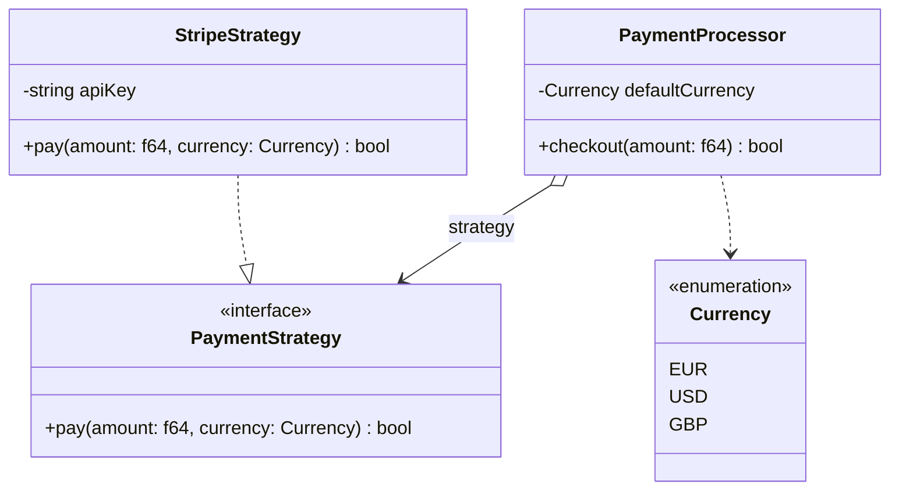
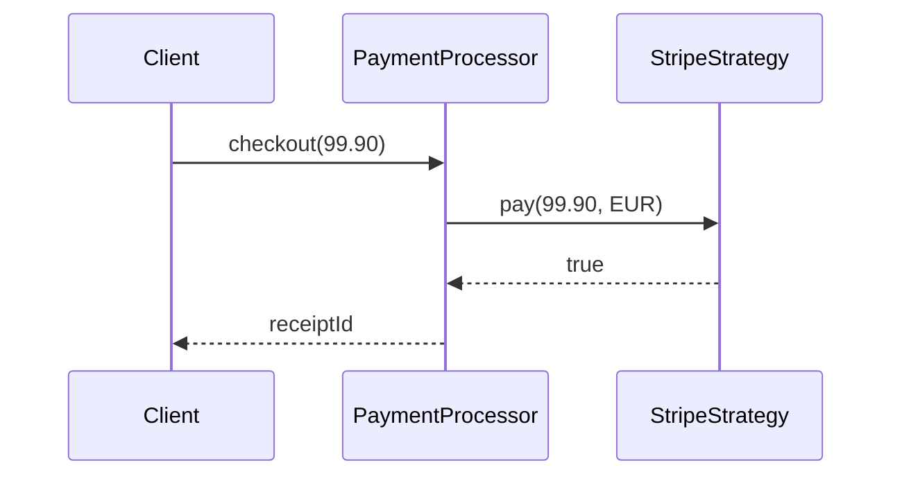
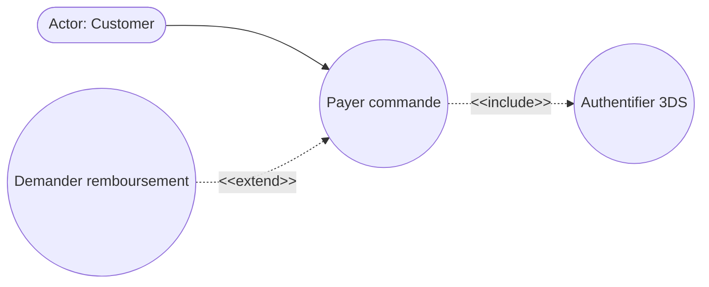
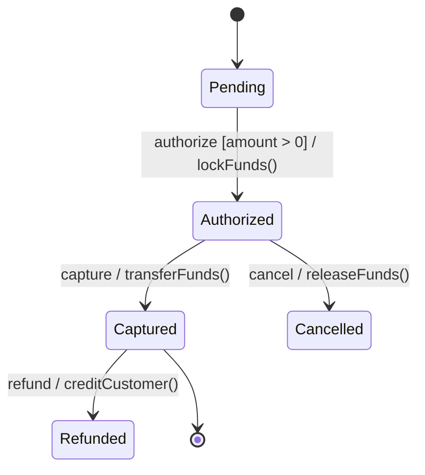
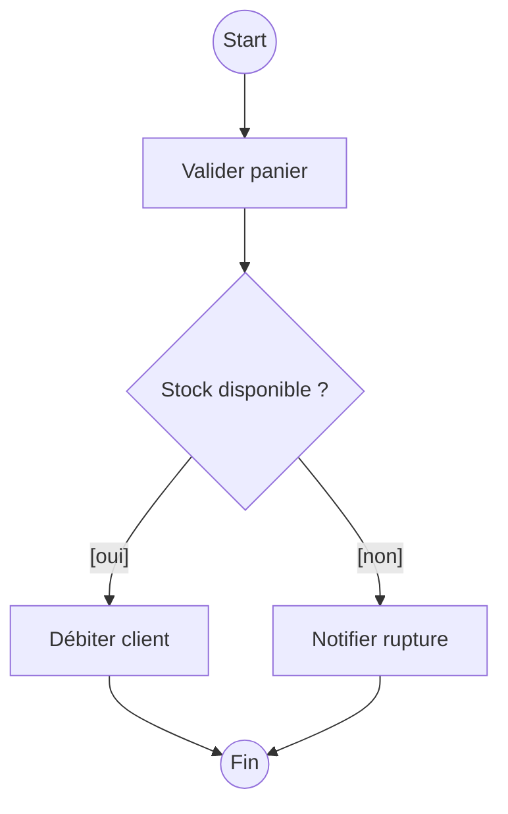
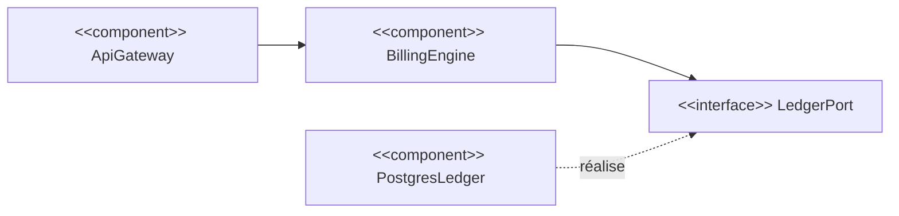
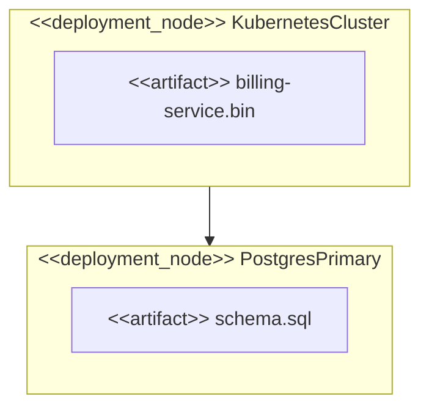
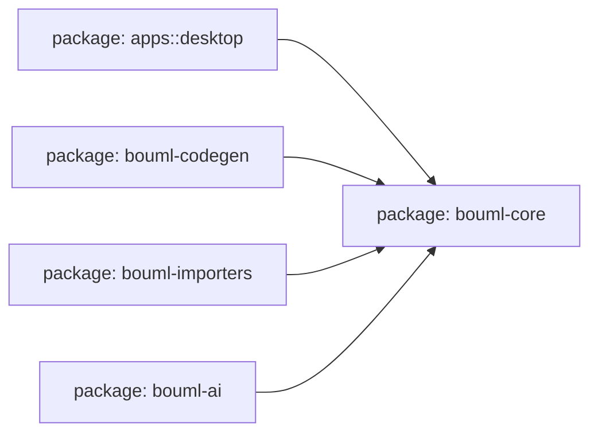
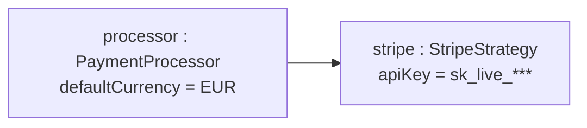

# Exemples Complets par Type de Diagramme UML 2.5

Ce document présente un exemple concret, prêt à l'emploi, pour **chacun des 9 types de diagrammes UML 2.5** supportés par **BouML Next** (modèle sémantique YAML / `UmlGraphPatch` JSON / commandes CLI + aperçu visuel).

> **Astuce :** Tous les blocs JSON `UmlGraphPatch` ci-dessous peuvent être appliqués directement dans un projet via :
> ```bash
> bouml init ./demo.bouml --name Demo
> bouml ai-apply ./demo.bouml ./exemple.json
> ```

---

## 1. Diagramme de Classes (`class`)

Modélise la structure statique : classes, interfaces, énumérations, attributs typés, opérations, héritages, réalisations, agrégations/compositions et dépendances.

### Aperçu visuel


### Exemple `UmlGraphPatch` JSON (applicable via `bouml ai-apply`)
```json
{
  "summary": "Pattern Strategy pour le traitement des paiements",
  "packages": [
    { "name": "billing", "comment": "Domaine de facturation" }
  ],
  "classifiers": [
    {
      "name": "Currency",
      "package": "billing",
      "kind": "enumeration",
      "literals": ["EUR", "USD", "GBP"]
    },
    {
      "name": "PaymentStrategy",
      "package": "billing",
      "kind": "interface",
      "is_abstract": true,
      "operations": [
        {
          "name": "pay",
          "visibility": "public",
          "is_abstract": true,
          "params": [
            { "name": "amount", "type": "f64" },
            { "name": "currency", "type": "Currency" }
          ],
          "return_type": "bool"
        }
      ]
    },
    {
      "name": "StripeStrategy",
      "package": "billing",
      "kind": "class",
      "properties": [
        { "name": "api_key", "type": "string", "visibility": "private", "multiplicity": "1" }
      ],
      "operations": [
        {
          "name": "pay",
          "visibility": "public",
          "params": [
            { "name": "amount", "type": "f64" },
            { "name": "currency", "type": "Currency" }
          ],
          "return_type": "bool",
          "bodies": {
            "rust": "amount > 0.0 && !self.api_key.is_empty()",
            "python": "return amount > 0 and bool(self.api_key)"
          }
        }
      ]
    },
    {
      "name": "PaymentProcessor",
      "package": "billing",
      "kind": "class",
      "properties": [
        { "name": "default_currency", "type": "Currency", "visibility": "private", "multiplicity": "1" }
      ],
      "operations": [
        {
          "name": "checkout",
          "visibility": "public",
          "params": [{ "name": "amount", "type": "f64" }],
          "return_type": "bool"
        }
      ]
    }
  ],
  "relations": [
    { "source": "StripeStrategy", "target": "PaymentStrategy", "kind": "interface_realization" },
    { "source": "PaymentProcessor", "target": "PaymentStrategy", "kind": "aggregation", "role_name": "strategy", "multiplicity": "1" },
    { "source": "PaymentProcessor", "target": "Currency", "kind": "dependency" }
  ],
  "diagrams": [
    {
      "name": "Billing Strategy",
      "kind": "class",
      "elements": ["PaymentProcessor", "PaymentStrategy", "StripeStrategy", "Currency"]
    }
  ]
}
```

---

## 2. Diagramme de Séquence (`sequence`)

Modélise les interactions chronologiques entre lignes de vie (`Lifeline`), appels synchrones/asynchrones et réponses (`Interaction` de première classe en UML 2.5).

### Aperçu visuel


### Exemple `UmlGraphPatch` JSON
```json
{
  "summary": "Séquence de paiement Stripe",
  "interactions": [
    {
      "name": "CheckoutSequence",
      "package": "billing",
      "lifelines": ["Client", "PaymentProcessor", "StripeStrategy"],
      "messages": [
        { "from": "Client", "to": "PaymentProcessor", "label": "checkout(99.90)", "sort": "sync_call" },
        { "from": "PaymentProcessor", "to": "StripeStrategy", "label": "pay(99.90, EUR)", "sort": "sync_call" },
        { "from": "StripeStrategy", "to": "PaymentProcessor", "label": "true", "sort": "reply" },
        { "from": "PaymentProcessor", "to": "Client", "label": "receiptId", "sort": "reply" }
      ]
    }
  ],
  "diagrams": [
    { "name": "Checkout Flow", "kind": "sequence", "elements": [] }
  ]
}
```

---

## 3. Diagramme de Cas d'Utilisation (`use_case`)

Modélise les acteurs métier, les cas d'utilisation et leurs relations `include` / `extend`.

### Aperçu visuel


### Exemple `UmlGraphPatch` JSON
```json
{
  "summary": "Cas d'utilisation e-commerce",
  "classifiers": [
    { "name": "Customer", "kind": "actor" },
    { "name": "PayOrder", "kind": "use_case", "comment": "Règlement d'une commande" },
    { "name": "Authenticate3DS", "kind": "use_case" },
    { "name": "RequestRefund", "kind": "use_case" }
  ],
  "relations": [
    { "source": "Customer", "target": "PayOrder", "kind": "association" },
    { "source": "PayOrder", "target": "Authenticate3DS", "kind": "include" },
    { "source": "RequestRefund", "target": "PayOrder", "kind": "extend" }
  ],
  "diagrams": [
    {
      "name": "Checkout Use Cases",
      "kind": "use_case",
      "elements": ["Customer", "PayOrder", "Authenticate3DS", "RequestRefund"]
    }
  ]
}
```

---

## 4. Diagramme d'États-Transitions (`state_machine`)

Modélise le cycle de vie d'une entité avec états, déclencheurs (`trigger`), gardes (`guard`) et effets (`effect`).

### Aperçu visuel


### Exemple `UmlGraphPatch` JSON
```json
{
  "summary": "Cycle de vie d'un paiement",
  "state_machines": [
    {
      "name": "PaymentLifecycle",
      "package": "billing",
      "states": ["Pending", "Authorized", "Captured", "Cancelled", "Refunded"],
      "transitions": [
        { "from": "Pending", "to": "Authorized", "trigger": "authorize", "guard": "amount > 0", "effect": "lockFunds()" },
        { "from": "Authorized", "to": "Captured", "trigger": "capture", "effect": "transferFunds()" },
        { "from": "Authorized", "to": "Cancelled", "trigger": "cancel", "effect": "releaseFunds()" },
        { "from": "Captured", "to": "Refunded", "trigger": "refund", "effect": "creditCustomer()" }
      ]
    }
  ],
  "diagrams": [
    { "name": "Payment State Machine", "kind": "state_machine", "elements": [] }
  ]
}
```

---

## 5. Diagramme d'Activités (`activity`)

Modélise un flux métier ou algorithmique avec nœuds de contrôle (`initial`, `decision`, `fork`, `join`, `activity_final`), actions et partitions (swimlanes).

### Aperçu visuel


### Exemple YAML `.bouml/` (`model/billing/behaviors/order_workflow.activity.yaml`)
```yaml
id: 01JACTIVITY000000000000001
name: OrderWorkflow
package_id: pkg_billing
nodes:
  - id: n_init
    name: Start
    kind: initial
  - id: n_validate
    name: ValidateCart
    kind: action
    partition: CheckoutService
  - id: n_check
    name: StockCheck
    kind: decision
    partition: InventoryService
  - id: n_charge
    name: ChargeCustomer
    kind: action
    partition: BillingService
  - id: n_end
    name: End
    kind: activity_final
edges:
  - id: e1
    source_id: n_init
    target_id: n_validate
  - id: e2
    source_id: n_validate
    target_id: n_check
  - id: e3
    source_id: n_check
    target_id: n_charge
    guard: "stock >= quantity"
  - id: e4
    source_id: n_charge
    target_id: n_end
```

---

## 6. Diagramme de Composants (`component`)

Modélise l'architecture logicielle en composants découplés reliés par interfaces et dépendances.

### Aperçu visuel


### Exemple `UmlGraphPatch` JSON
```json
{
  "summary": "Architecture hexagonale en composants",
  "classifiers": [
    { "name": "ApiGateway", "kind": "component" },
    { "name": "BillingEngine", "kind": "component" },
    { "name": "LedgerPort", "kind": "interface", "is_abstract": true },
    { "name": "PostgresLedger", "kind": "component" }
  ],
  "relations": [
    { "source": "ApiGateway", "target": "BillingEngine", "kind": "dependency" },
    { "source": "BillingEngine", "target": "LedgerPort", "kind": "dependency" },
    { "source": "PostgresLedger", "target": "LedgerPort", "kind": "interface_realization" }
  ],
  "diagrams": [
    {
      "name": "System Components",
      "kind": "component",
      "elements": ["ApiGateway", "BillingEngine", "LedgerPort", "PostgresLedger"]
    }
  ]
}
```

---

## 7. Diagramme de Déploiement (`deployment`)

Modélise les nœuds d'infrastructure (`DeploymentNode` : serveurs, clusters Kubernetes, conteneurs) et les artefacts déployés (`Artifact`).

### Aperçu visuel


### Exemple YAML `.bouml/` (`model/infra/kubernetes_cluster.yaml`)
```yaml
id: 01JNODE0000000000000000001
name: KubernetesCluster
package_id: pkg_infra
kind: deployment_node
visibility: public
tagged_values:
  region: eu-west-1
  replicas: "3"
```

---

## 8. Diagramme de Packages (`package`)

Modélise le découpage modulaire haut niveau et les dépendances entre domaines afin de prévenir les dépendances circulaires.

### Aperçu visuel


### Création via la CLI
```bash
bouml init ./architecture.bouml --name BoumlNext
bouml add-class ./architecture.bouml --name Project --package bouml-core
bouml add-class ./architecture.bouml --name CodegenEngine --package bouml-codegen
bouml add-class ./architecture.bouml --name TreeSitterImporter --package bouml-importers
bouml validate ./architecture.bouml
```

---

## 9. Diagramme d'Objets (`object`)

Modélise un instantané d'instances concrètes à l'exécution (valeurs d'attributs et liens entre objets).

### Aperçu visuel


### Exemple YAML de vue (`diagrams/checkout_snapshot.diagram.yaml`)
```yaml
id: 01JDIAG0000000000000000009
name: Checkout Runtime Snapshot
kind: object
package_id: pkg_billing
layout_mode: auto_elk
element_ids:
  - clf_payment_processor
  - clf_stripe_strategy
```
